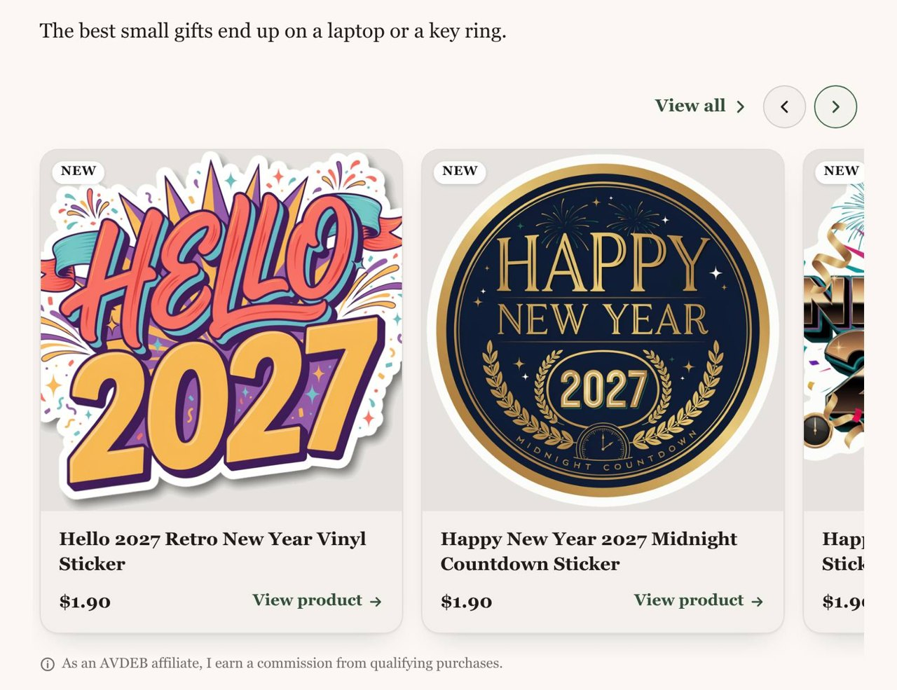

# AVDEB Products for MODX

Show [AVDEB](https://avdeb.com/developers/#modx) products on your MODX site (a creator's shop, a category, a search or a single product) with **your affiliate referral code on every link**.



- **Snippets:** `[[!AvdebProducts]]`, `[[!AvdebProduct]]` and `[[!AvdebButton]]` work in any resource, template or chunk.
- **Tags in content:** type `{avdeb-products https://avdeb.com/category/stickers/}` in any resource, even in rich text editors that don't allow MODX tags. A plugin turns tags into products.
- **Four layouts:** grid, carousel (scroll-snap with keyboard and arrow buttons), list ("shop the post") and spotlight. Single products render as a horizontal card, a hero or a compact card, with your own badge and note.
- **Fits your design:** container queries let embeds adapt to the column they sit in. Choose inherit, light, dark or system theme, plus card style, accent colour, radius and image shape. Styles use `:where()` (zero specificity), so your CSS always wins, and `--avdeb-*` custom properties restyle everything. Or render each product with your own `&tpl` chunk.
- **Fast and resilient:** products are fetched on the server and kept in the MODX cache. If AVDEB can't be reached, the last good copy is shown for a week. The stylesheet and the small carousel script load only on pages that show products.
- **Honest links:** referral links get `rel="sponsored"`, and an optional affiliate disclosure appears under embeds that carry a code.
- **Private by default:** no third-party scripts, cookies, iframes or tracking. The secret key stays on the server.

## Requirements

- MODX Revolution 3.0 or later
- PHP 8.1 or later (the `intl` extension gives localised prices; without it prices use a simple format)

## Installation

*Extras → Installer → Download Extras*, search for **AVDEB Products** and install it.

Or download `avdeb-1.0.0-pl.transport.zip` from the [releases](https://github.com/Avdebcom/modx-avdeb/releases), then in *Extras → Installer* use *Upload a package* (the arrow next to *Download Extras*), and install it.

## Configuration

*System → System Settings*, namespace **avdeb**:

| Setting | |
| --- | --- |
| `avdeb.ref_code` | Your referral code, added as `?ref=` to every link |
| `avdeb.api_key` | Optional secret key (`avdeb_sk_…`): your code is added automatically and embeds can show up to 48 products (12 without). Leave it empty to use the `AVDEB_SECRET_KEY` environment variable instead. |
| `avdeb.layout`, `avdeb.columns`, `avdeb.card_style`, `avdeb.theme`, `avdeb.accent_color`, `avdeb.radius`, `avdeb.image_ratio`, `avdeb.cta_label` | Display defaults (each embed can override them) |
| `avdeb.show_price`, `avdeb.show_creator`, `avdeb.show_badges`, `avdeb.new_tab` | Card details |
| `avdeb.locale` | Price locale (empty: the site's `cultureKey`) |
| `avdeb.include_assets` | Load the stylesheet and carousel script on pages with products |
| `avdeb.show_disclosure`, `avdeb.disclosure_text` | Affiliate disclosure |
| `avdeb.cache_minutes` | How long fetched products stay fresh (default 360) |

Clearing the site cache (*Manage → Clear Cache*) refreshes products right away.

### Become an AVDEB affiliate

Free to join: 5% commission, 30-day cookie, monthly PayPal payouts in USD ($50 minimum), open worldwide.
Apply at [avdeb.com/affiliate/apply](https://avdeb.com/affiliate/apply/). After approval, copy your referral code (or create a secret key) in the [partner dashboard](https://avdeb.com/affiliate/dashboard/developers/).

## Usage

### Snippets

```html
<!-- Any AVDEB creator, category or product link; the source is detected automatically -->
[[!AvdebProducts? &url=`https://avdeb.com/creators/cleo/` &heading=`From my shop`]]

[[!AvdebProducts? &tag=`stickers` &layout=`carousel` &columns=`4` &limit=`10`]]
[[!AvdebProducts? &q=`keychain` &layout=`list` &limit=`3`]]
[[!AvdebProducts? &tag=`3d-prints` &layout=`spotlight` &theme=`dark` &accent=`#e0a84f`]]

[[!AvdebProduct? &product=`https://avdeb.com/store/custom-qr-code-stickers/` &variant=`hero` &badge=`Editor's pick` &note=`I use it every day.`]]

[[!AvdebButton? &href=`/creators/cleo/` &label=`Visit my shop` &variant=`outline` &align=`center`]]
```

Call them uncached (`[[!…]]`). Products are cached by the extra itself, so pages stay fast and prices stay current.

`AvdebProducts` properties: `&url`, `&creator`, `&tag`, `&type`, `&q` (leave all empty for the newest products), `&limit`, `&layout`, `&columns`, `&heading`, `&intro`, `&headingLevel`, `&viewAll`, `&cardStyle`, `&theme`, `&accent`, `&radius`, `&ratio`, `&buttonText`, `&hidePrice`, `&hideCreator`, `&newTab`.
`AvdebProduct`: `&product` (a product link or handle), `&variant` (horizontal, hero, card), `&badge`, `&note`, plus the display properties.
`AvdebButton`: `&href`, `&label`, `&variant` (solid, outline, link), `&align` (start, center, end).

### Tags in content

```text
{avdeb-products https://avdeb.com/creators/cleo/ layout="carousel" limit="8" heading="From my shop"}
{avdeb-products https://avdeb.com/category/stickers/ layout="list" limit="3"}
{avdeb-product https://avdeb.com/store/custom-qr-code-keychain/ variant="hero" badge="Editor's pick"}
{avdeb-button href="/creators/cleo/" label="Visit my shop" variant="outline" align="center"}
```

The first value is a creator, category or product link (detected automatically) or search words. A tag alone in a paragraph replaces the whole paragraph. Write `{{avdeb-products}}` to show a tag as text.

### Your own markup

```html
[[!AvdebProducts? &tag=`stickers` &limit=`4` &tpl=`myProductTpl` &outputSeparator=``]]
```

`myProductTpl` chunk:

```html
<li><a href="[[+href]]" rel="[[+rel]]"> [[+title]] — [[+price]]</a></li>
```

Placeholders: `[[+href]]` (with your referral code), `[[+rel]]`, `[[+target]]`, `[[+title]]`, `[[+image]]`, `[[+width]]`, `[[+height]]`, `[[+price]]`, `[[+compareAt]]`, `[[+discount]]`, `[[+isNew]]`, `[[+creator]]`, `[[+idx]]`. Every value is HTML-escaped. After the call, `[[+avdeb.viewAll]]`, `[[+avdeb.disclosure]]` and `[[+avdeb.total]]` are set. Add `&toPlaceholder=`name`` to output into a placeholder instead.

## Styling

Every rule is `:where()`-wrapped, so your CSS wins. Set tokens in your stylesheet:

```css
.avdeb {
	--avdeb-accent: #7c3aed;
	--avdeb-radius: 4px;
	--avdeb-card-bg: #fff;
	--avdeb-font-title: Georgia, serif;
}
```

Tokens: `--avdeb-accent`, `--avdeb-accent-contrast`, `--avdeb-surface`, `--avdeb-card-bg`, `--avdeb-card-pad`, `--avdeb-border`, `--avdeb-muted`,
`--avdeb-badge-bg`, `--avdeb-badge-text`, `--avdeb-shadow`, `--avdeb-shadow-hover`, `--avdeb-radius`, `--avdeb-ratio`, `--avdeb-gap`, `--avdeb-pad`,
`--avdeb-font-title`, `--avdeb-heading-size`, `--avdeb-title-size`, `--avdeb-price-size`, `--avdeb-btn-bg`, `--avdeb-btn-color`, `--avdeb-btn-shadow`.

The markup uses stable BEM classes (`.avdeb`, `.avdeb--{layout}`, `.avdeb-card`, `.avdeb-card__title`, `.avdeb-card__price`, `.avdeb-btn`…). To use only your own CSS, set `avdeb.include_assets` to No.

## How it works

- The snippets and the plugin call `https://api.avdeb.com/v1/catalog/products` from your server. With a secret key, requests send `Authorization: Bearer avdeb_sk_…` and the API returns links that already carry your code; without one, `?ref=` is added to every link.
- Each query is cached in the `avdeb` cache partition (`core/cache/avdeb/`, or your cache handler). Fresh results are reused for `avdeb.cache_minutes`; a failed request falls back to the last good result (up to a week old) and retries after 15 minutes. At most 30 API calls a minute are made.
- All product data is validated before rendering: only `https://avdeb.com` links and `https://` images get through, and every value is escaped.
- Uninstalling removes the snippets, the plugin and the files. The system settings stay, so a reinstall keeps your configuration.

## Development

```sh
php tests/run.php                # unit tests for the catalog client, options and renderer (no MODX needed)
tests/dev-site.sh                # throw-away MODX 3 site in Docker with the package built and installed → http://localhost:8098/manager/
tests/smoke.sh                   # fresh site: install, render, clear the cache, uninstall
```

`tests/dev-site.sh` also writes the installable package to `_packages/avdeb-1.0.0-pl.transport.zip`. To build it in your own MODX site, run `php _build/build.transport.php /path/to/modx`.

## Support

Issues and ideas: [github.com/Avdebcom/modx-avdeb/issues](https://github.com/Avdebcom/modx-avdeb/issues). More integrations: [avdeb.com/developers](https://avdeb.com/developers/).

## License

MIT © AVDEB
